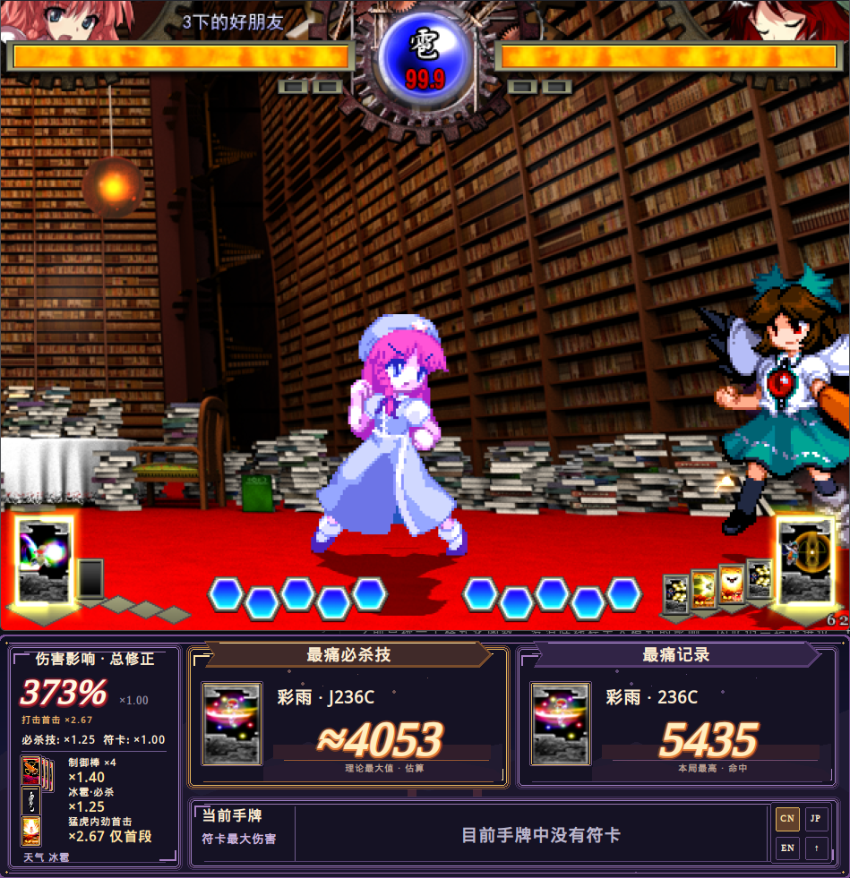
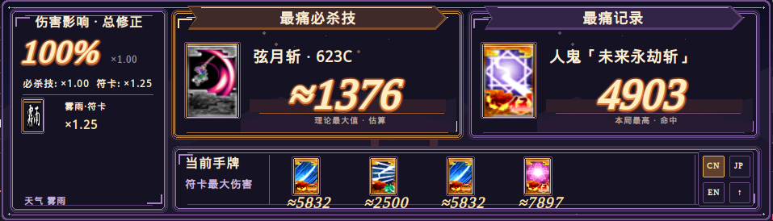

# SokuMaxDamageHUD · 什么最痛

[简体中文](README.md) · **English** · [日本語](README.ja.md)

A damage reference HUD for **Touhou Hisoutensoku v1.10a**. A companion panel below the game shows estimated move damage, active modifiers and the best recorded hit. Chinese, Japanese and English interfaces are available.

**Battle data is read-only.** The mod reads runtime battle state for estimates and display. It does not change actual damage, character stats or battle state, modify network packets, interfere with the random number generator (RNG), or send gameplay inputs. Image extraction leaves the original game archives untouched; generated images and UI preferences are stored in the mod’s own folder.



*Full interface*



*HUD detail*

## Install

Requires Hisoutensoku v1.10a with a working mod loader: SokuLauncher, SokuModLoader or SWRSToys.

1. Close the game. Download `SokuMaxDamageHUD-vVERSION-win32.zip` from [Releases](https://github.com/HawkingChen/SokuMaxDamageHUD/releases/latest), rather than Source code.
2. Extract the **`SokuMaxDamageHUD` folder** from the ZIP into the game's **`modules`** folder.
3. Enable **SokuMaxDamageHUD** on SokuLauncher's mods page and start the game.

The DLL should be at `GAME/modules/SokuMaxDamageHUD/SokuMaxDamageHUD.dll`.

<details>
<summary>Using SWRSToys directly</summary>

Add this line under `[Module]` in the `SWRSToys.ini` used by your installation:

```ini
SokuMaxDamageHUD=modules/SokuMaxDamageHUD/SokuMaxDamageHUD.dll
```

Enable the DLL only once; avoid duplicate entries under different names.

</details>

**No separate artwork download is needed.** On the first launch, the mod extracts card and weather images from your local `th123a.dat` / `th123b.dat` / `th123c.dat` into its `icons` folder. It leaves the archives and existing images untouched, works offline, and needs no Python or extra script. If artwork is missing, check your game archives, write access to the mod folder, and `IconExtraction.log`. Text placeholders remain available if extraction fails.

To update, back up the old folder, close the game, and replace the files with the new version. To uninstall, disable the mod in your launcher, then delete its `SokuMaxDamageHUD` folder.

## Use

- **Damage modifiers**: the large percentage is the common attack/defense modifier. Guts appears in grey; special and spell multipliers are separate. Stacked cards show effects and their counts.
- **Strongest special**: the highest estimated damage among known available special moves. Equal-damage B/C variants may share a caption such as `623B/C`.
- **Best hit**: the highest recorded single-move damage this match, including normals and spells.
- **Current hand**: estimated spell damage in hand order.
- **CN / JP / EN** changes language. **↑** collapses the panel; **＋** expands it. Preferences are saved automatically.

Use windowed mode and leave room below the game. The panel appears in supported battle modes and hides when you leave battle or switch to another application.

## Limitations

- `≈` means an estimate, not a full simulation. Move level, hit count, positioning and some special states affect the result. A first-hit bonus is not applied to an entire multi-hit move estimate.
- Records track projectile casting sources and sum hits from the same cast. Overlapping sources and unusual mechanics may still be unidentified. Some move data is incomplete.
- Online host/client, spectating, replays and mod combinations have not all been validated in-game. This mod does not modify game damage or network packets.
- Automatic image extraction requires a new build containing this feature; older release ZIPs do not gain it automatically.

## Feedback and credits

Report problems in [Issues](https://github.com/HawkingChen/SokuMaxDamageHUD/issues), including the mod version, game mode, characters, move and a screenshot or reproduction steps.

Damage references include [Cleista Framedata](https://soku.cleista.cc/framedata). Japanese skill and spell names have been checked against the original v1.10a card tables. Artwork is generated from the player's own game and is not distributed in this repository or release ZIP; game assets belong to their respective rights holders.

[Building from source](docs/BUILD.md) · [MIT code license](LICENSE)
