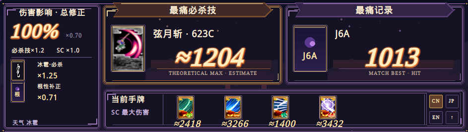

# SokuMaxDamage · 什么最痛

[简体中文](README.md) · [English](README.en.md) · **日本語**

『東方非想天則』**v1.10a** 用のダメージ表示 MOD です。ゲームウィンドウの下に、技の推定ダメージ、各種補正、対戦中の最大ダメージ記録を表示します。中国語・日本語・英語に対応しています。



## 導入方法

MOD を読み込める環境（SokuLauncher / SokuModLoader / SWRSToys）と、非想天則 v1.10a が必要です。

1. ゲームを終了し、[Releases](https://github.com/HawkingChen/SokuMaxDamage/releases/latest) から `SokuMaxDamage-vバージョン番号-win32.zip` をダウンロードします。Source code ではありません。
2. ZIP 内の **`WhatHurtsMost` フォルダー**を、ゲームの **`modules`** フォルダーに展開します。
3. **SokuLauncher の MOD 一覧で SokuMaxDamage を有効化**して、ゲームを起動します。

DLL の配置先は `ゲームフォルダー/modules/WhatHurtsMost/WhatHurtsMost.dll` です。`WhatHurtsMost` は既存環境との互換性のために残している内部名で、別の MOD ではありません。

<details>
<summary>SWRSToys を直接使用する場合</summary>

使用中の `SWRSToys.ini` の `[Module]` セクションに追加します。

```ini
SokuMaxDamage=modules/WhatHurtsMost/WhatHurtsMost.dll
```

同じ DLL を別名の項目で重複して読み込まないでください。

</details>

**カード画像の別途ダウンロードは不要です。** 初回起動時に、お使いのゲームの `th123a.dat` / `th123b.dat` / `th123c.dat` からカードと天候の画像を読み出し、MOD の `icons` フォルダーに保存します。元のアーカイブや既存画像は変更しません。ネット接続、Python、追加スクリプトも不要です。画像が出ない場合は、ゲームのデータファイル、MOD フォルダーへの書き込み権限、`IconExtraction.log` を確認してください。抽出に失敗しても文字の代替表示は利用できます。

更新時は旧フォルダーをバックアップし、ゲームを終了してから新版のファイルを上書きしてください。削除する場合は、ランチャーで無効化してから `WhatHurtsMost` フォルダーを削除します。

## 使い方

- **ダメージ補正**：大きなパーセント表示は攻撃・防御の共通補正です。根性補正は灰色、必殺技とスペルカードの補正は別枠で表示します。重なったカードで効果と枚数を確認できます。
- **最大ダメージ必殺技**：使用可能な既知の必殺技のうち、推定ダメージが最も高い技です。B/C 版が同ダメージの場合は `623B/C` のようにまとめます。
- **最大ダメージ記録**：その対戦で記録した単一技の最大ダメージです。通常技やスペルカードも対象です。
- **手札**：手札の順番にスペルカードの推定ダメージを表示します。
- **CN / JP / EN** で言語を切り替えます。**↑** で折りたたみ、**＋** で元に戻します。設定は自動保存されます。

ウィンドウモードを使用し、ゲームの下に表示スペースを確保してください。対応する対戦モードでのみ表示され、対戦終了時や別のアプリに切り替えた際は非表示になります。

## 制限事項

- `≈` は推定値を表します。完全なダメージシミュレーターではありません。技のレベル、ヒット数、位置、一部の特殊状態によって実際の結果は変わります。初段強化を多段技全体の推定値に掛けることはありません。
- 遅れて当たる弾や多段技では、ダメージの技への帰属が不正確になることがあります。未収録の技データもあります。
- ネット対戦のホスト・クライアント、観戦、リプレイ、他の MOD との組み合わせは、すべての実機確認を終えていません。ゲームのダメージや通信パケットは変更しません。
- 画像の自動抽出には、この機能を含む新しいビルドが必要です。過去のリリース ZIP には自動で追加されません。

## 不具合報告・クレジット

[Issues](https://github.com/HawkingChen/SokuMaxDamage/issues) に、MOD のバージョン、モード、キャラクター、技、スクリーンショットまたは再現手順を添えて報告してください。

ダメージ参考資料には [Cleista Framedata](https://soku.cleista.cc/framedata) などを使用しています。日本語のスキル・スペルカード名は、原版 v1.10a のカード名と照合しています。画像は各自のゲームから生成し、リポジトリや配布 ZIP には同梱しません。ゲーム素材の権利は各権利者に帰属します。

[ソースからのビルド](docs/BUILD.md) · [コードの MIT ライセンス](LICENSE)
